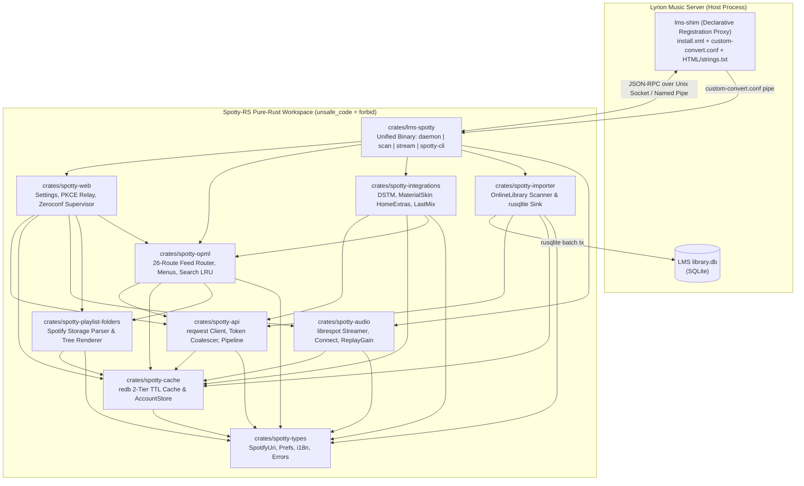
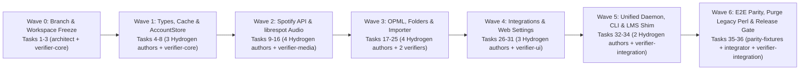

# Spotty-RS Complete Perl-to-Rust Conversion & Native Swarm Implementation Plan

> **For agentic workers:** REQUIRED SUB-SKILL: Use `swarm` (Carbon Coordinator + Hydrogen Workers) paired with `rust-pro` and `superpowers:test-driven-development` to execute this plan wave-by-wave. Steps use checkbox (`- [ ]`) syntax for tracking.

**Goal:** Convert `Spotty-Plugin` (`v4.62.3`, 7,417 LOC across 23 Perl modules + 5 vendored CPAN modules + 7 prebuilt `spotty` binaries) completely into a unified, zero-`unsafe` 10-crate Rust workspace (`lms-spotty`) on dedicated branch `rust-conversion` with 100% Lyrion Music Server (LMS) functional parity.

**Architecture:** Replace all 23 Perl business-logic modules, 5 vendored CPAN libraries, and external `Bin/` helper blobs with a single compiled Rust workspace (`crates/*`) running in three integrated personas: (1) **`lms-spotty daemon`** (async `tokio` JSON-RPC sidecar over Unix domain socket / Windows Named Pipe / loopback TCP handling OPML feeds, Spotify Web API, OAuth PKCE, Settings viewmodels, Connect discovery, and DSTM/LastMix/HomeExtras), (2) **`lms-spotty scan`** (native `rusqlite` LMS `library.db` online-library importer matching `slimserver/rust`), and (3) **`lms-spotty stream` / `spotty` CLI** (in-process `librespot` PCM/FLAC/MP3 audio pipeline + Zeroconf authenticator). LMS loads a declarative ~45-line zero-logic RPC proxy shim (`lms-shim/`) or optional `cdylib` XS bridge while preserving `install.xml`, `strings.txt`, `custom-convert.conf`, and Template Toolkit HTML assets.

**Tech Stack:** Rust 2021 (`cargo 1.99.1`), `tokio`, `reqwest` (`rustls-tls`, `gzip`), `librespot-{core,playback,connect,discovery,metadata}`, `rusqlite` (`bundled`), `redb` (2-tier persistent TTL cache), `serde` / `serde_json`, `thiserror`, `rand`, `sha2`, `md-5`, `base64`, `url`, `clap`, `wiremock`, `proptest`.

**Spec:** Self-contained in §1–§4 of this document; upon branch creation (Task 1), mirror canonical copies to `docs/superpowers/specs/2026-11-19-spotty-rust-design.md` and `docs/superpowers/plans/2026-11-19-spotty-rust-conversion.md` on branch `rust-conversion`.

---

## Global Constraints

- **Git Branch Isolation:** `master` (`f7ae969`, synced to `origin/master` and `upstream/master`) MUST remain untouched. All conversion commits land exclusively on dedicated branch `rust-conversion`.
- **Swarm Model Pinning:** Coordinator runs on **Gemini 4 Carbon (High)** (`gemini-4-carbon-high` / `Orchestrator (Carbon)`). Every spawned worker MUST explicitly pin **Hydrogen**: `model: "gemini-4-hydrogen-high"` for architecture, core protocol/API/audio/SQLite authors, and verifiers; `model: "gemini-4-hydrogen-medium"` for `monitor`, template/i18n/config authors, and packaging tasks.
- **Google Rust Style Bible & Zero-Unsafe Gate (`GRS-001`–`GRS-012`):**
  - `[workspace.lints.rust] unsafe_code = "forbid"` across all pure-Rust crates (`spotty-*` and `lms-spotty`).
  - `lib.rs` and `mod.rs` MUST contain **only** `mod` declarations and `pub use` re-exports (`GRS-003`); all `struct`, `enum`, `trait`, and `fn` definitions live in leaf `.rs` files.
  - `imports_granularity = "Module"` (`GRS-001`: zero `::` inside `{ ... }`), zero glob imports outside `#[cfg(test)]` (`GRS-002`), zero `.unwrap()` in production (`GRS-010`), zero `catch_unwind` (`GRS-004`), zero poisoned mutex `.into_inner()` (`GRS-007`), zero `get_` prefixes on getters (`GRS-011`), closure lock accessors (`with_foo`, `with_mut_foo`), `#[non_exhaustive]` on cross-crate public structs/enums, `#[must_use]` on pure constructors/accessors, code width `<= 100` cols, comments `<= 80` cols (`GRS-012`), and zero opaque `bool` parameters (use 2-variant `enum`s).
- **Mandatory Static & Compiler Verification Gate:** Every task wave MUST pass `cargo fmt --all -- --check`, `cargo check --workspace --all-targets`, `cargo clippy --workspace --all-targets -- -D warnings`, `python C:\Users\jmolina\.gemini\config\plugins\rust-pro\skills\rust-pro\scripts\google_rust_audit.py . --strict`, and `cargo test --workspace` before branch merge.
- **Atomic Worker Scope (`GLB-020` / Invariant 68):** Every worker task targets **1–3 leaf files** (`<= 400 LOC`) with **at most 4 steps**, running in isolated `workspace: "share"` copies so two authors never edit the same file. Never `kill` a `share` worker until its verified commits are merged into `rust-conversion`.
- **Windows Encoding & Release Binary Hygiene:** UTF-8 explicit I/O everywhere (`WIN-ENC-001`); `[profile.release]` uses `opt-level = 3`, `lto = "thin"`, `codegen-units = 1`, `panic = "abort"`, `strip = "symbols"` (matching `S:\Github\DJMix-LMS` and `S:\Github\slimserver\rust`).

## Review Focus

Seven concrete failure modes and upstream Perl bugs discovered during our 9-scout forensic audit—each pinned by a dedicated regression test in its owning task:

1. **Combined 5-Seed Overflow on Recommendations (`DontStopTheMusic.pm:68,101`):** Upstream Perl caps `seed_tracks` at 5 and `seed_artists` at 5 independently (sending up to 10 seeds), causing Spotify `GET /v1/recommendations` to reject requests with `HTTP 400`. `RecommendationSeeds::build` in Task 26 enforces `tracks.len() + artists.len() <= 5` (prioritizing tracks).
2. **Mixed Track + Episode Batch Dual-Completion Hazard (`API.pm:606–607`):** Upstream Perl fires the caller callback twice when a playlist mixes `spotify:track:*` and `spotify:episode:*` URIs. `SpotifyClient::tracks_and_episodes` in Task 13 uses `tokio::try_join!` to return a single merged vector preserving input order.
3. **Expired File Loop-Mutation Wiping Valid Playlist Folder Caches (`PlaylistFolders.pm:430`):** Upstream Perl writes `$delete ||= (stat($f))[9] < $cutoff` inside a `for` loop, so encountering one >30-day-old file deletes every subsequent file regardless of age. `FolderCache::purge_expired` in Task 21 evaluates expiration per entry immutably.
4. **Empty Search Double-Callback Crash (`LastMix.pm:33–35`) & `topTracks` Typo (`OPML.pm:604`):** Upstream `LastMix::lookup` omits `return` after empty-result callback, and `OPML::topTracks` calls non-existent `tracksList()`. Fixed by typed single-return `Result<Option<MatchedTrack>, _>` (Task 27) and `format_track_list` (Task 18).
5. **Non-Deterministic Batch Reassembly (`API/Pipeline.pm:183`):** Upstream sorts string `md5_hex` chunk keys with numeric `<=>` (evaluating hex strings as `0`). `Pipeline::execute_chunks` in Task 11 indexes chunks by `usize` ordinal.
6. **Spotify-Owned Playlist 24h Snapshot Sentinel (`Importer.pm:296,356`):** Spotify editorial playlists (`creator == "spotify"`) mutate without reliable snapshot tracking in LMS unless `snapshot_ids` stores a 10-digit Unix epoch `now + 86400` sentinel treated as a deadline by `needs_update`. Pinned in Task 24.
7. **Corrupt `credentials.json` Recovery & Latin-1 Username Folder Hashing (`AccountHelper.pm:140,325`):** Account folder IDs MUST equal `substr(md5_hex(latin1_transliterate(username)), 0, 8)` for existing user cache compatibility, and malformed `credentials.json` files MUST be backed up to `credentials-<unix_ts>.json` before directory removal. Pinned in Task 6.

---

## 1. Complete Perl-to-Rust Codebase Mapping (100% Coverage)

Every line of the legacy 7,417-LOC Perl codebase maps deterministically to a target Rust crate and leaf module:

| Legacy Source File(s) | Legacy LOC | Target Rust Crate & Leaf Modules | Key Porting Transformation |
| :--- | ---: | :--- | :--- |
| `install.xml`, `strings.txt`, `custom-types.conf` | 1,232 | `crates/spotty-types/src/{manifest.rs, i18n.rs, uri.rs, prefs.rs, error.rs}` | Compile-time/startup `strings.txt` parser; `IconCode` 32-hex newtype; `SpotifyUri` parser (`spotify:*` + `open.spotify.com/[intl-xx/]*`). |
| `lib/{Bytes,Clone,Crypt,Hash,Math}/**` | ~1,650 | **Deleted** (`crates/spotty-cache/src/merge.rs` + `rand`) | 100% pure-Perl CPAN vendor tree eliminated; `Hash::Merge` `NO_DUPLICATES` replaced by deterministic `merge_metadata_json`. |
| `AccountHelper.pm`, `API/Cache.pm` | 683 | `crates/spotty-cache/src/{backend.rs, metadata_cache.rs, account_store.rs, merge.rs, gc.rs}` | `redb`-backed 2-tier TTL store (HTTP/app short TTL + 90d metadata cache); 8-hex MD5 `AccountId`, `__AUTHENTICATE__` atomic promotion, 12-hex MAC preservation. |
| `API.pm`, `API/Token.pm`, `API/Pipeline.pm`, `API/Sync.pm`, `API/AsyncRequest*.pm` | 2,525 | `crates/spotty-api/src/{transport.rs, rate_limit.rs, token.rs, pipeline.rs, normalize.rs, catalog.rs, library.rs, browse.rs}` | Unified `reqwest` + `rustls-tls` client (eliminating `SSL_verify_mode => 0` and `AsyncRequestLegacy`); single-flight `tokio::sync::watch` token refresh; `FailFast` (server) vs `SleepAndRetry` (scanner) 429 policies. |
| `ProtocolHandler.pm`, `Helper.pm`, `custom-convert.conf`, `Bin/*` | 526 + 46 MB | `crates/spotty-audio/src/{streamer.rs, connect.rs, transcode.rs, replaygain.rs, cli_compat.rs}` | Direct in-process `librespot` integration (`44.1kHz/16-bit/2ch` PCM, FLAC/MP3 pipe, `--start-position` seek, ReplayGain, Zeroconf `--authenticate`, `--check` JSON capability output). |
| `Plugin.pm`, `OPML.pm` | 2,367 | `crates/spotty-opml/src/{router.rs, home.rs, artist_view.rs, formatters.rs, menus.rs, search_lru.rs, transfer.rs}` | All 26 OPML routes as typed `OpmlRoute` enum; `tokio::try_join!` 3-way artist barrier; explicit-content 3-mode filter; alphabetical index buckets; recent-searches CLI (`LRU 50`). |
| `PlaylistFolders.pm` | 450 | `crates/spotty-playlist-folders/src/{parser.rs, discovery.rs, tree.rs, upload.rs}` | Safe `<= 512 KiB` state-machine parser (`start-group`/`end-group`), Latin-1/UTF-8 name decoder, `0.8` hit-ratio matcher, OPML `outline` tree builder, multipart upload handler. |
| `Importer.pm` | 503 | `crates/spotty-importer/src/{schema_sink.rs, track_prep.rs, scan_albums.rs, scan_artists.rs, scan_playlists.rs, needs_update.rs}` | Direct `rusqlite` writer into LMS `library.db` (`tracks`, `contributors`, `playlist_track`), `OnlineLibrary` watermarks (`7d` TTL), daily `spotify` snapshot sentinel. |
| `DontStopTheMusic.pm`, `HomeExtras.pm`, `LastMix.pm` | 353 | `crates/spotty-integrations/src/{dstm.rs, home_extras.rs, last_mix.rs}` | `<= 5` combined seed recommender, 5 MaterialSkin hero descriptors, single-return `LastMix` track matcher. |
| `Settings.pm`, `Settings/*.pm` (5 files) | 840 | `crates/spotty-web/src/{basic.rs, auth.rs, pkce_callback.rs, player.rs, player_auth.rs, playlist_folders_ui.rs}` | PKCE S256 + `api.lms-community.org` OAuth relay, 15-min abortable Zeroconf supervisor, CSRF route metadata, exact Template Toolkit `serde::Serialize` viewmodels. |
| Unified Binary + LMS Bridge | New | `crates/lms-spotty/src/{main.rs, daemon.rs, rpc_protocol.rs, lifecycle.rs}` + `lms-shim/` | Single binary (`daemon`, `scan`, `stream`, legacy `spotty` flags) + minimal declarative LMS RPC forwarder shim. |

---

## 2. Architecture & Crate Dependency DAG



---

## 3. Native Swarm Topology: Carbon Orchestrator + Hydrogen Subagents

### 3.1 Model & Quota Configuration (Verified Live via `swarm{action:"models", all:true}`)

| Swarm Tier | Roster Role(s) | Exact Model Identifier | Display Name | Workspace Mode | Rationale |
| :--- | :--- | :--- | :--- | :--- | :--- |
| **Orchestrator** | `coordinator` (Main Thread) | `gemini-4-carbon-high` | **Gemini 4 Carbon (High)** | `s:\Github\Spotty-Plugin` (`rust-conversion`) | Architectural governance, channel routing, wave gating, merge sequencing, zero inline coding (`native_swarm` rule). |
| **Stall Watchdog** | `monitor` | `gemini-4-hydrogen-medium` | **Gemini 4 Hydrogen (Medium)** | `inherit` | Required because `swarm_monitor` is installed; wakes only on full-swarm silence to break stalls. (`swarm_narrator` is not installed, so no `narrator` is spawned.) |
| **Lead Architect & Shepherd** | `architect`, `integrator` | `gemini-4-hydrogen-high` | **Gemini 4 Hydrogen (High)** | `share` | Freezes workspace Cargo/lint scaffolding & cross-crate traits (Wave 0); cherry-picks/merges verified branches into `rust-conversion`. |
| **Core Crate Authors (12)** | `types-auth`, `cache-store`, `api-transport`, `api-endpoints`, `audio-stream`, `audio-connect`, `opml-core`, `opml-menus`, `folders-lib`, `importer-db`, `integrations`, `web-settings`, `daemon-cli` | `gemini-4-hydrogen-high` | **Gemini 4 Hydrogen (High)** | `share` | Concurrent implementation in isolated working copies on strictly disjoint leaf `.rs` files (`1–3` files / task). |
| **Shim & Asset Authors (2)** | `lms-shim`, `parity-fixtures` | `gemini-4-hydrogen-medium` | **Gemini 4 Hydrogen (Medium)** | `share` | Mechanical declarative RPC shim, `custom-convert.conf` updates, golden JSON/OPML fixture synthesis. |
| **Dedicated Verifiers (4)** | `verifier-core`, `verifier-media`, `verifier-ui`, `verifier-integration` | `gemini-4-hydrogen-high` | **Gemini 4 Hydrogen (High)** | `inherit` | 1 verifier per ~3 authors. Runs `cargo fmt`, `clippy -D warnings`, `google_rust_audit.py --strict`, and `cargo test`; reports defects to `@<author>` without editing author files. |

> **Quota Resilience Protocol:** Live quota on the Gemini 4 pool is currently `38%` (resets `2026-11-20T00:31:50Z`). Instead of spawning all 20 workers simultaneously on Turn 1, the Carbon Coordinator spawns **only active-wave workers + `monitor`** (4–7 active Hydrogen workers per wave), keeping idle workers asleep (`waiting` costs zero tokens) and retiring completed waves cleanly *after* `integrator` merges their commits into `rust-conversion`.

### 3.2 Swarm Channels & Communication Discipline

If the `swarm` runtime exposes `action: "channel"`, create 5 domain channels before adding area workers so `main` carries only cross-crate announcements and `[done]` wave gates:

1. `#foundation` — `architect`, `types-auth`, `cache-store`, `verifier-core`, `integrator`
2. `#spotify-net` — `api-transport`, `api-endpoints`, `audio-stream`, `audio-connect`, `verifier-media`
3. `#lms-features` — `opml-core`, `opml-menus`, `folders-lib`, `integrations`, `verifier-ui`
4. `#persistence-web` — `importer-db`, `web-settings`, `daemon-cli`, `lms-shim`, `verifier-integration`
5. `#release-qa` — `parity-fixtures`, `integrator`, `verifier-integration`

**Board Hygiene Rules Enforced in Every Worker Brief:**
- `@mention` is a wakeup doorbell, never a CC: authors `@mention` **only** their assigned `@verifier-*` upon task commit (`@verifier-core [ready] Task 5 committed on <branch> @ <sha>`).
- Verifiers inspect the commit by `#seq` reference, run the 5-command verification suite, and either send defects back (`@cache-store fix GRS-001 import grouping in merge.rs:14`) or certify upward (`@integrator [verified] #12 passes fmt/clippy/GRS/tests @ <sha>`).
- `integrator` fast-forwards/merges certified commits into `rust-conversion`, verifies workspace green state, and posts `@coordinator [done] Wave <N> landed @ <sha>`.

### 3.3 Wave Execution DAG



### 3.4 Canonical Hydrogen Worker Brief Template

Every `swarm{action:"add"}` call issued by the Carbon Coordinator MUST follow this self-contained contract (workers start with zero prior conversation history):

```text
swarm{
  action: "add",
  name: "<worker-name>",
  model: "gemini-4-hydrogen-high",
  workspace: "share",
  brief: "Project: Spotty-RS full Perl-to-Rust port on branch `rust-conversion` in s:\\Github\\Spotty-Plugin.
You own ONLY: <exact 1-3 leaf file paths>. Do NOT edit lib.rs/mod.rs beyond wiring your leaf module, and NEVER touch files outside your slice.
Mandatory Style Contract (enforced by google_rust_audit.py --strict & clippy -D warnings):
- Zero unsafe (`unsafe_code = forbid`), zero `.unwrap()` in non-test code, zero `get_` prefixes on getters, zero `bool` params (use 2-variant enums), `#[non_exhaustive]` on pub structs/enums, `#[must_use]` on pure constructors/getters.
- `imports_granularity = Module` (one module per `use`, zero `::` inside `{}`), code <= 100 cols, comments <= 80 cols.
- `lib.rs` / `mod.rs` contain ONLY `mod` and `pub use`.
Assignment (Task <N>): <exact interfaces consumed/produced + 4 TDD steps>.
Done criteria: Run `cargo test -p <crate>`, `cargo clippy -p <crate> --all-targets -- -D warnings`, and `python C:\\Users\\jmolina\\.gemini\\config\\plugins\\rust-pro\\skills\\rust-pro\\scripts\\google_rust_audit.py crates/<crate> --strict` (0 violations). Commit on your share branch and post `@<verifier> [done] Task <N> committed @ <sha> — <test summary>` (do NOT @coordinator unless blocked)."
}
```

---

## 4. Bite-Sized Implementation Tasks (36 Atomic TDD Slices Across 7 Waves)

### Wave 0: Dedicated Rust Branch, Cargo Workspace & Contract Freeze

### Task 1: Create `rust-conversion` Branch, Workspace Root & Google Style Configs

**Swarm Owner:** `architect` (`gemini-4-hydrogen-high`, `workspace: "share"`) -> `verifier-core`

**Files:**
- Create: `Cargo.toml`
- Create: `rustfmt.toml`
- Create: `.cargo/config.toml`

**Interfaces:**
- Consumes: Clean `master` HEAD (`f7ae969`).
- Produces: Branch `rust-conversion`; Cargo workspace (`resolver = "2"`, `members = ["crates/*"]`), `[workspace.lints.rust]` (`unsafe_code = "forbid"`, `unsafe_op_in_unsafe_fn = "deny"`, `missing_docs = "warn"`), `[workspace.lints.clippy]` (exact drop-in from `rust-pro/references/google-lint-and-fmt-config.md`), `[profile.release]` (`opt-level = 3`, `lto = "thin"`, `codegen-units = 1`, `panic = "abort"`, `strip = "symbols"`), and Google Rust Style `rustfmt.toml`.

- [ ] **Step 1: Create branch `rust-conversion` and write `Cargo.toml`, `rustfmt.toml`, and `.cargo/config.toml`**
  Checkout `git checkout -b rust-conversion` from `f7ae969`; persist this plan and spec under `docs/superpowers/plans/2026-11-19-spotty-rust-conversion.md` and write the workspace manifests with initial stub crate `crates/spotty-types`.
- [ ] **Step 2: Verify `cargo check` fails before stub `crates/spotty-types/Cargo.toml` exists, then add minimal `crates/spotty-types/{Cargo.toml,src/lib.rs}`**
  `crates/spotty-types/src/lib.rs` must be empty or comment-only (`GRS-003`).
- [ ] **Step 3: Run workspace lint, format, and `google_rust_audit.py` checks**
  Run: `cargo fmt --all -- --check; cargo clippy --workspace --all-targets -- -D warnings; python 'C:\Users\jmolina\.gemini\config\plugins\rust-pro\skills\rust-pro\scripts\google_rust_audit.py' crates --strict`
  Expected: Exit `0` with `0` violations.
- [ ] **Step 4: Commit workspace scaffold on `rust-conversion`**
  `git commit -m "chore(workspace): initialize rust-conversion branch and Google Rust Style workspace"`

---

### Task 2: Scaffold All 10 Workspace Crates (`Cargo.toml` + Pure-Manifest `lib.rs`)

**Swarm Owner:** `architect` (`gemini-4-hydrogen-high`) -> `verifier-core`

**Files:**
- Create: `crates/{spotty-cache,spotty-api,spotty-audio,spotty-opml,spotty-playlist-folders,spotty-importer,spotty-integrations,spotty-web,lms-spotty}/Cargo.toml`
- Create: `crates/{spotty-cache,spotty-api,spotty-audio,spotty-opml,spotty-playlist-folders,spotty-importer,spotty-integrations,spotty-web}/src/lib.rs` and `crates/lms-spotty/src/main.rs`

**Interfaces:**
- Consumes: Workspace `[workspace.dependencies]` and `[workspace.lints]` from Task 1.
- Produces: Compiling 10-crate DAG matching §2 with `[lints] workspace = true` in every crate so Wave 1–5 workers never collide on root `Cargo.toml`.

- [ ] **Step 1: Add all shared crate dependencies to `[workspace.dependencies]` in root `Cargo.toml`**
  Pin `tokio`, `reqwest` (`rustls-tls`, `gzip`, `json`), `serde`, `serde_json`, `thiserror`, `redb`, `rusqlite` (`bundled`), `rand`, `sha2`, `md-5`, `base64`, `url`, `clap`, `tracing`, `wiremock`, `proptest`, `tempfile`, and `librespot-*` (`0.6` / upstream `spotty` compatible).
- [ ] **Step 2: Create member `Cargo.toml` files and empty `lib.rs` manifests (`main.rs` returning `ExitCode::SUCCESS` in `lms-spotty`)**
- [ ] **Step 3: Verify full workspace compiles and passes `google_rust_audit.py --strict`**
  Run: `cargo check --workspace --all-targets; cargo clippy --workspace --all-targets -- -D warnings; python 'C:\Users\jmolina\.gemini\config\plugins\rust-pro\skills\rust-pro\scripts\google_rust_audit.py' crates --strict`
  Expected: Exit `0`.
- [ ] **Step 4: Commit 10-crate skeleton**
  `git commit -m "chore(workspace): scaffold 10-crate Spotty-RS dependency graph"`

---

### Task 3: Core Host & Error Traits (`spotty-types/src/{error.rs, host.rs}`)

**Swarm Owner:** `architect` (`gemini-4-hydrogen-high`) -> `verifier-core`

**Files:**
- Create: `crates/spotty-types/src/error.rs`
- Create: `crates/spotty-types/src/host.rs`
- Modify: `crates/spotty-types/src/lib.rs`

**Interfaces:**
- Consumes: `thiserror`, `serde`.
- Produces: `#[non_exhaustive] pub enum SpottyError` (`RateLimited { retry_after_secs: u64, endpoint: String }`, `NoAccessToken`, `InvalidGrant`, `InvalidUri(String)`, `Http(String)`, `Cache(String)`, `Database(String)`, `Audio(String)`, `Io(String)`), `pub type Result<T> = std::result::Result<T, SpottyError>`, `ClientId(String)` newtype, and `pub trait LmsHostCallbacks: Send + Sync` (`notify_new_metadata`, `trigger_online_library_rescan`, `execute_playlist_command`).

- [ ] **Step 1: Write unit tests in `error.rs` verifying `RateLimited` display, UI error key mapping (`PLUGIN_SPOTTY_ERROR_429`), and `ClientId` MAC normalization**
- [ ] **Step 2: Run `cargo test -p spotty-types` and confirm failure**
- [ ] **Step 3: Implement `SpottyError`, `ClientId`, and `LmsHostCallbacks` in `error.rs` and `host.rs`, re-exporting from `lib.rs`**
- [ ] **Step 4: Verify `cargo test -p spotty-types`, `clippy`, and `google_rust_audit.py --strict`, then commit**

---

### Wave 1: Domain Types, `strings.txt` i18n, 2-Tier `redb` Cache & `AccountStore`

### Task 4: Spotify URI Parser & Manifest/IconCode Types (`spotty-types/src/{uri.rs, manifest.rs}`)

**Swarm Owner:** `types-auth` (`gemini-4-hydrogen-high`) -> `verifier-core`

**Files:**
- Create: `crates/spotty-types/src/uri.rs`
- Create: `crates/spotty-types/src/manifest.rs`
- Modify: `crates/spotty-types/src/lib.rs`

**Interfaces:**
- Consumes: `SpottyError` (Task 3), `install.xml`.
- Produces: `#[non_exhaustive] pub enum SpotifyEntityKind { Track, Episode, Album, Artist, Playlist, Show, User }`, `pub struct SpotifyUri { kind: SpotifyEntityKind, id: String }` (`FromStr` handling `spotify:track:<22>`, `spotify://track:<22>`, `spotify:user:foo:playlist:<22>`, and `https://open.spotify.com/[intl-de/]track/<22>?si=...`, plus `to_colon_uri()`, `to_protocol_url()`), `pub struct IconCode(String)` (validating `^[a-fA-F0-9]{32}$` + `DEFAULT_ICON_HASH = "93aac68fb06348598c1e67734dfaceee"`), and `PluginManifest::from_install_xml(&str)`.

- [ ] **Step 1: Write `proptest` and unit tests in `uri.rs` and `manifest.rs` covering `spotify://` slash-stripping (`ProtocolHandler.pm:127`), `intl-*` open URLs (`OPML.pm:522`), legacy `spotify:user:*:playlist:*`, `IconCode` validation (`Plugin.pm:81`), and `install.xml` parsing**
- [ ] **Step 2: Run `cargo test -p spotty-types` to confirm compile/test failure**
- [ ] **Step 3: Implement `SpotifyUri`, `SpotifyEntityKind`, `IconCode`, and `PluginManifest`**
- [ ] **Step 4: Run `cargo test -p spotty-types`, `clippy`, and `google_rust_audit.py`, then commit**

---

### Task 5: Plugin & Per-Player Preferences + `strings.txt` Localization Engine (`spotty-types/src/{prefs.rs, i18n.rs}`)

**Swarm Owner:** `types-auth` (`gemini-4-hydrogen-high`) -> `verifier-core`

**Files:**
- Create: `crates/spotty-types/src/prefs.rs`
- Create: `crates/spotty-types/src/i18n.rs`
- Modify: `crates/spotty-types/src/lib.rs`

**Interfaces:**
- Consumes: `IconCode`, `ClientId`, `strings.txt` (1,206 lines).
- Produces: `#[non_exhaustive] pub enum Bitrate { Kbps96, Kbps160, Kbps320 }`, `pub enum ExplicitFilterMode { AllowAll, HideExplicit, StrictMaster }`, `pub enum SortOrder { Alphabetical, NaturalOrder }`, `pub enum ApFallbackPolicy { DefaultPort, ForcePort12321 }`, `pub struct GlobalPrefs` (all defaults + v1/v3 migrations from `Plugin.pm:60-116`), `pub struct PlayerPrefs` (`replaygain`, `explicit_filter`, `reverse_podcast_order`, `ignore_home_items`, `account_id`), and `pub struct StringCatalog` (`parse_strings_txt(&str)` + ` lookup(token, lang) -> &str` with `EN` fallback).

- [ ] **Step 1: Write unit tests parsing the real repository `strings.txt` (`PLUGIN_SPOTTY_NAME`, `KBPS` in `EN`/`DE`/`FR`) and verifying v1/v3 pref migrations (`spt-flc-*-*` on ARM vs x86/Win/Mac)**
- [ ] **Step 2: Run `cargo test -p spotty-types` to verify failure**
- [ ] **Step 3: Implement `prefs.rs` and `i18n.rs` using 2-variant/3-variant enums (zero `bool` parameters)**
- [ ] **Step 4: Run `cargo test -p spotty-types`, `clippy`, and `google_rust_audit.py`, then commit**

---

### Task 6: `AccountStore` & Corrupt-Credential Recovery (`spotty-cache/src/{account_store.rs, gc.rs}`)

**Swarm Owner:** `cache-store` (`gemini-4-hydrogen-high`) -> `verifier-core`

**Files:**
- Create: `crates/spotty-cache/src/account_store.rs`
- Create: `crates/spotty-cache/src/gc.rs`
- Modify: `crates/spotty-cache/src/lib.rs`

**Interfaces:**
- Consumes: `spotty-types` (`ClientId`, `SpottyError`, `Result`).
- Produces: `pub struct AccountId(String)` (`from_username(&str)` computing 8-hex MD5 of Latin-1 transliterated username matching `AccountHelper.pm:140`), `pub struct CredentialsRecord { pub username: String, pub auth_type: u32, pub auth_data: String }`, `pub struct AccountStore` (`cache_folders`, `promote_authenticate_folder`, `credentials`, `all_credentials`, `player_credentials`, `delete_account`, `purge_cache(PurgeScope::PreservePlayerMacs | PurgeScope::FullInit)`), and `TempAudioGc` (sweeping stale `.tmp[a-z0-9]{6}` > 3600s).

- [ ] **Step 1: Write tests in `account_store.rs` using `tempfile::TempDir` for: (a) Non-ASCII username Latin-1 MD5 folder ID parity, (b) `__AUTHENTICATE__` atomic promotion overwriting stale folder, (c) corrupt `credentials.json` backed up to `credentials-<ts>.json` before cleanup (Review Focus #7), and (d) 12-hex MAC folder preservation during non-init purge**
- [ ] **Step 2: Run `cargo test -p spotty-cache` to verify failure**
- [ ] **Step 3: Implement `account_store.rs` and `gc.rs` with closure lock accessors (`with_cached_accounts`)**
- [ ] **Step 4: Run `cargo test -p spotty-cache`, `clippy`, and `google_rust_audit.py`, then commit**

---

### Task 7: `NO_DUPLICATES` Metadata Deep-Merge & Tag Cleaner (`spotty-cache/src/merge.rs`)

**Swarm Owner:** `cache-store` (`gemini-4-hydrogen-high`) -> `verifier-core`

**Files:**
- Create: `crates/spotty-cache/src/merge.rs`
- Modify: `crates/spotty-cache/src/lib.rs`

**Interfaces:**
- Consumes: `serde_json::Value`.
- Produces: `pub fn merge_no_duplicates(existing: &Value, incoming: &Value) -> Value` (replacing `lib/Hash/Merge.pm`: right-precedence scalars, recursive object merge preserving existing `image`/`added_at` when incoming omits them, array concatenation deduplicated by element `"uri"`), `pub fn cleanup_tags(text: &str) -> String` (`API/Cache.pm` Deluxe/Remastered/Edition/Anniversary stripper), and `pub fn largest_artwork_url(images: &[ArtworkImage]) -> &str`.

- [ ] **Step 1: Write property and unit tests verifying partial track/album merges preserve `album.image` and `added_at`, deduplicate track arrays by `uri`, and strip `(2011 Remaster)` / `[Deluxe Edition]` accurately**
- [ ] **Step 2: Run `cargo test -p spotty-cache` to verify failure**
- [ ] **Step 3: Implement `merge.rs` without external `Hash::Merge` quirks**
- [ ] **Step 4: Run `cargo test -p spotty-cache`, `clippy`, and `google_rust_audit.py`, then commit**

---

### Task 8: Two-Tier Persistent `redb` Cache (`spotty-cache/src/{backend.rs, metadata_cache.rs}`)

**Swarm Owner:** `cache-store` (`gemini-4-hydrogen-high`) -> `verifier-core`

**Files:**
- Create: `crates/spotty-cache/src/backend.rs`
- Create: `crates/spotty-cache/src/metadata_cache.rs`
- Modify: `crates/spotty-cache/src/lib.rs`

**Interfaces:**
- Consumes: `redb`, `merge_no_duplicates` (Task 7), `SpottyError`.
- Produces: `pub enum WritePolicy { MergeExisting, FastSkipIfPresent, OverwriteDirect }`, `pub struct DualCache` wrapping a single `redb::Database` with two tables: `ephemeral_kv` (short-lived HTTP responses with `etag`/`last_modified`, tokens, 7d artist/episode/watermark keys, 30d playlist owners) and `metadata_90d` (90-day `spotify:track:*` / `spotify:album:*` / `linked_from.uri` aliases merged via `merge_no_duplicates`).

- [ ] **Step 1: Write tests for TTL expiry, `FastSkipIfPresent` (`API/Cache.pm` `$fast=1`), `linked_from.uri` dual-key indexing, and HTTP ETag cached body retrieval**
- [ ] **Step 2: Run `cargo test -p spotty-cache` to confirm failure**
- [ ] **Step 3: Implement `backend.rs` and `metadata_cache.rs`**
- [ ] **Step 4: Run `cargo test -p spotty-cache`, `clippy`, and `google_rust_audit.py`, then commit**

---

### Wave 2: Spotify Web API v1 Client (`reqwest`) & In-Process `librespot` Audio/Connect Engine

### Task 9: OAuth2 PKCE & Single-Flight Token Manager (`spotty-api/src/token.rs`)

**Swarm Owner:** `api-transport` (`gemini-4-hydrogen-high`) -> `verifier-media`

**Files:**
- Create: `crates/spotty-api/src/token.rs`
- Modify: `crates/spotty-api/src/lib.rs`

**Interfaces:**
- Consumes: `DualCache`, `AccountStore` (Tasks 6, 8), `IconCode`, `reqwest::Client`.
- Produces: `pub const SPOTIFY_API_SCOPES: &[&str]` (13 API scopes + 21 PKCE callback scopes), `pub struct PkceChallenge { pub verifier: String, pub challenge_s256: String }`, `pub struct TokenManager` (`exchange_pkce_code`, `access_token_for(user_id)` with startup-epoch access token key `TTL = expires_in - 300s`, 180-day refresh token persistence, `tokio::sync::Mutex<HashMap<String, watch::Receiver<...>>>` single-flight refresh coalescing, and `invalid_grant` -> `AccountStore::delete_account` reset).

- [ ] **Step 1: Write `wiremock` tests proving 10 concurrent `access_token_for` calls issue exactly **1** `POST /api/token` refresh request, and `invalid_grant` purges the account cleanly**
- [ ] **Step 2: Run `cargo test -p spotty-api` to verify failure**
- [ ] **Step 3: Implement `token.rs`**
- [ ] **Step 4: Run `cargo test -p spotty-api`, `clippy`, and `google_rust_audit.py`, then commit**

---

### Task 10: HTTP Transport, RFC 3986 Query Serializer & Dual 429 Rate-Limit Gate (`spotty-api/src/{rate_limit.rs, transport.rs}`)

**Swarm Owner:** `api-transport` (`gemini-4-hydrogen-high`) -> `verifier-media`

**Files:**
- Create: `crates/spotty-api/src/rate_limit.rs`
- Create: `crates/spotty-api/src/transport.rs`
- Modify: `crates/spotty-api/src/lib.rs`

**Interfaces:**
- Consumes: `TokenManager` (Task 9), `DualCache` (Task 8).
- Produces: `pub enum RateLimitPolicy { FailFastServer, SleepAndRetryScanner }`, `pub enum CacheRevalidation { Conditional, SkipRevalidate }`, `pub struct RateLimitGate` (`is_tripped`, `trip(Duration)`, `clear`), and `pub struct SpotifyTransport` (`reqwest` + `rustls-tls`, 30s timeout, gzip, sorted query params with `~` -> `%7E`, token-salted MD5 cache keys for `me*` and `browse*`, `If-None-Match` stripping `-gzip`, `Cache-Control: max-age` + Spotify route fallback TTLs: `60s` default, `3600s` `/me` & user playlists, `28800s`/`3600s` editorial playlists).

- [ ] **Step 1: Write `wiremock` tests covering: (a) `429` with `Retry-After: 2` under `FailFastServer` vs `SleepAndRetryScanner`, (b) `304 Not Modified` serving cached body with `from_cache = true`, and (c) TLS verification active (no `SSL_verify_mode => 0`)**
- [ ] **Step 2: Run `cargo test -p spotty-api` to confirm failure**
- [ ] **Step 3: Implement `rate_limit.rs` and `transport.rs`**
- [ ] **Step 4: Run `cargo test -p spotty-api`, `clippy`, and `google_rust_audit.py`, then commit**

---

### Task 11: Deterministic Async Paginator & Batch Pipeline (`spotty-api/src/pipeline.rs`)

**Swarm Owner:** `api-transport` (`gemini-4-hydrogen-high`) -> `verifier-media`

**Files:**
- Create: `crates/spotty-api/src/pipeline.rs`
- Modify: `crates/spotty-api/src/lib.rs`

**Interfaces:**
- Consumes: `SpotifyTransport` (Task 10).
- Produces: `pub struct Pipeline` supporting: (1) `fetch_offset_parallel` (page 0 probe -> propagate `SkipRevalidate` if `from_cache` -> semaphore-bounded parallel offset fan-out sorted by `usize` offset), (2) `fetch_cursor_serial` (`after=([a-zA-Z0-9]{22})` chain), and (3) `execute_indexed_chunks` (explicit `(usize, QueryParams)` preserving input chunk order, fixing `API/Pipeline.pm:183` Review Focus #5).

- [ ] **Step 1: Write `wiremock` tests for 175-item offset pagination (4 pages), cursor `after=` pagination, and indexed chunk reassembly determinism**
- [ ] **Step 2: Run `cargo test -p spotty-api` to verify failure**
- [ ] **Step 3: Implement `pipeline.rs`**
- [ ] **Step 4: Run `cargo test -p spotty-api`, `clippy`, and `google_rust_audit.py`, then commit**

---

### Task 12: Spotify Entity Models & Normalization (`spotty-api/src/{models.rs, normalize.rs}`)

**Swarm Owner:** `api-endpoints` (`gemini-4-hydrogen-high`) -> `verifier-media`

**Files:**
- Create: `crates/spotty-api/src/models.rs`
- Create: `crates/spotty-api/src/normalize.rs`
- Modify: `crates/spotty-api/src/lib.rs`

**Interfaces:**
- Consumes: `DualCache`, `merge.rs` (`largest_artwork_url`, `cleanup_tags`).
- Produces: Typed `#[non_exhaustive]` normalized structs `NormalizedTrack`, `NormalizedAlbum`, `MinAlbum`, `NormalizedArtist`, `NormalizedPlaylist`, `NormalizedShow`, `NormalizedEpisode`, `PlayerState`, `UserProfile`, `Category`, plus normalizers stripping HTML `<.+?>` from descriptions, injecting `minAlbum`/`minShow`, mapping episodes to track-compatible views, persisting 90d track/album + `linked_from` records, 7d artist/episode records, and 30d `playlist_owner_<id>`.

- [ ] **Step 1: Write JSON fixture tests against real Spotify v1 album/track/playlist/show/episode payloads verifying `minAlbum` injection, HTML stripping, `linked_from` caching, and `is_playable` filtering**
- [ ] **Step 2: Run `cargo test -p spotty-api` to verify failure**
- [ ] **Step 3: Implement `models.rs` and `normalize.rs`**
- [ ] **Step 4: Run `cargo test -p spotty-api`, `clippy`, and `google_rust_audit.py`, then commit**

---

### Task 13: Catalog, Search, Track/Episode Batching (`spotty-api/src/catalog.rs`)

**Swarm Owner:** `api-endpoints` (`gemini-4-hydrogen-high`) -> `verifier-media`

**Files:**
- Create: `crates/spotty-api/src/catalog.rs`
- Modify: `crates/spotty-api/src/lib.rs`

**Interfaces:**
- Consumes: `SpotifyTransport`, `Pipeline`, `models.rs`, `normalize.rs` (Tasks 10–12).
- Produces: `SpotifyClient` methods: `me`, `user`, `player`, `search`, `album` (auto-paginating >50 tracks), `artist`, `artists` (50-ID batches), `related_artists`, `artist_tracks`, `artist_albums`, `track_cached`, `tracks_and_episodes` (50-ID batches joined via `tokio::try_join!`, fixing Review Focus #2 dual-callback bug), `show`, `episodes`.

- [ ] **Step 1: Write `wiremock` tests including a mixed `["spotify:track:...", "spotify:episode:..."]` batch test asserting a single combined result and a 75-track album auto-pagination test**
- [ ] **Step 2: Run `cargo test -p spotty-api` to verify failure**
- [ ] **Step 3: Implement `catalog.rs`**
- [ ] **Step 4: Run `cargo test -p spotty-api`, `clippy`, and `google_rust_audit.py`, then commit**

---

### Task 14: User Library, Playlists, Browse & Recommendations Endpoints (`spotty-api/src/{library.rs, browse.rs}`)

**Swarm Owner:** `api-endpoints` (`gemini-4-hydrogen-high`) -> `verifier-media`

**Files:**
- Create: `crates/spotty-api/src/library.rs`
- Create: `crates/spotty-api/src/browse.rs`
- Modify: `crates/spotty-api/src/lib.rs`

**Interfaces:**
- Consumes: `SpotifyClient` (`catalog.rs`, `Pipeline`, `DualCache`).
- Produces: `my_songs`, `my_albums`, `my_albums_meta`, `is_in_my_albums` (50-ID chunks), `add_album_to_library`, `my_artists` (merging followed artists + album artists, plus sorted MD5 hash for scanner), `follow_artist`, `my_shows`, `add_show_to_library`, `playlist_tracks` (100/page up to 10,000 + optional `fields` projection), `user_playlists`, `add_tracks_to_playlist`, `new_releases`, `categories`, `category_playlists`, `home` (`0JQ5DAt0tbjZptfcdMSKl3`), `featured_playlists` (10-min rounded timestamp), and `recommendations` (`RecommendationSeeds` enforcing `<= 5` combined seeds).

- [ ] **Step 1: Write `wiremock` tests for `my_artists` hash calculation, `playlist_tracks` `added_at` sorting, `featured_playlists` 10-minute timestamp rounding, and `RecommendationSeeds` 5-seed cap**
- [ ] **Step 2: Run `cargo test -p spotty-api` to verify failure**
- [ ] **Step 3: Implement `library.rs` and `browse.rs`**
- [ ] **Step 4: Run `cargo test -p spotty-api`, `clippy`, and `google_rust_audit.py`, then commit**

---

### Task 15: In-Process `librespot` Audio Streamer, ReplayGain & Transcode Builder (`spotty-audio/src/{streamer.rs, replaygain.rs, transcode.rs}`)

**Swarm Owner:** `audio-stream` (`gemini-4-hydrogen-high`) -> `verifier-media`

**Files:**
- Create: `crates/spotty-audio/src/streamer.rs`
- Create: `crates/spotty-audio/src/replaygain.rs`
- Create: `crates/spotty-audio/src/transcode.rs`
- Modify: `crates/spotty-audio/src/lib.rs`

**Interfaces:**
- Consumes: `librespot_core`, `librespot_playback`, `AccountStore` (Task 6), `Bitrate`, `ApFallbackPolicy` (Task 5).
- Produces: `pub struct StreamRequest { cache_dir: PathBuf, uri: SpotifyUri, start_offset_secs: Option<u64>, bitrate: Bitrate, normalisation: NormalisationMode, ap_fallback: ApFallbackPolicy }`, `TrackStreamer::stream_pcm_s16le(req, AsyncWrite)` (`44_100 Hz`, 16-bit signed LE, 2-ch), `resolve_track_gain(client_replaygain, server_replaygain_mode, remote_gain)` (`ProtocolHandler.pm:38-49` anti-double-ReplayGain rule), and `TranscodeTableBuilder` (generating LMS `spt-pcm`, `spt-flc`, `spt-mp3` command strings + `strip_tmpdir_for_webui` matching `Plugin.pm:184-288`).

- [ ] **Step 1: Write unit tests for `resolve_track_gain` (returns `None` when client Spotty ReplayGain is enabled), `TranscodeTableBuilder` flag generation (`--bitrate`, `--enable-volume-normalisation`, `--ap-port=12321`, `TMPDIR=`), and PCM headerless frame formatting**
- [ ] **Step 2: Run `cargo test -p spotty-audio` to verify failure**
- [ ] **Step 3: Implement `streamer.rs`, `replaygain.rs`, and `transcode.rs`**
- [ ] **Step 4: Run `cargo test -p spotty-audio`, `clippy`, and `google_rust_audit.py`, then commit**

---

### Task 16: Spotify Connect / Zeroconf Authenticator & Legacy `spotty` CLI Flag Compatibility (`spotty-audio/src/{connect.rs, cli_compat.rs}`)

**Swarm Owner:** `audio-connect` (`gemini-4-hydrogen-high`) -> `verifier-media`

**Files:**
- Create: `crates/spotty-audio/src/connect.rs`
- Create: `crates/spotty-audio/src/cli_compat.rs`
- Modify: `crates/spotty-audio/src/lib.rs`

**Interfaces:**
- Consumes: `librespot_discovery`, `librespot_connect`, `clap`, `StreamRequest` (Task 15).
- Produces: `ZeroconfAuthenticator` (`run_with_timeout(cache_dir, device_name, Duration::from_secs(900))` writing `credentials.json`), `HelperCheckReport` (serializing exact `ok spotty v<ver>\n{...json capabilities...}` for `--check` backward compatibility: `autoplay`, `podcasts`, `volume-normalisation`, `no-ap-port`), `--get-token --access-token=<tok>` credential materializer, and `LegacySpottyArgs` parser accepting every flag used by `custom-convert.conf` and LMS.

- [ ] **Step 1: Write CLI flag parsing and `--check` output tests verifying line 1 matches `/^ok spotty v([\d\.]+)/i` and line 2+ parses as valid capability JSON (`Helper.pm:101-113`)**
- [ ] **Step 2: Run `cargo test -p spotty-audio` to verify failure**
- [ ] **Step 3: Implement `connect.rs` and `cli_compat.rs`**
- [ ] **Step 4: Run `cargo test -p spotty-audio`, `clippy`, and `google_rust_audit.py`, then commit**

---

### Wave 3: OPML Feed Engine, Playlist Folders & Native `rusqlite` Library Importer

### Task 17: OPML Types, Home Priority Sorter & 26-Route Feed Router (`spotty-opml/src/{router.rs, home.rs}`)

**Swarm Owner:** `opml-core` (`gemini-4-hydrogen-high`) -> `verifier-ui`

**Files:**
- Create: `crates/spotty-opml/src/router.rs`
- Create: `crates/spotty-opml/src/home.rs`
- Modify: `crates/spotty-opml/src/lib.rs`

**Interfaces:**
- Consumes: `SpotifyClient` (Tasks 13–14), `AccountStore` (Task 6), `GlobalPrefs`/`PlayerPrefs`/`StringCatalog` (Task 5).
- Produces: `#[non_exhaustive] pub struct OpmlNode` (`name`, `node_type`, `url`, `image`, `items`, `passthrough`, `playall`, `on_select`), `pub enum OpmlRoute` (all 26 browse/action routes + `home_heroes_*` MaterialSkin tags + `WithAccount` wrapper), `sort_home_items` (`Daily Mix|MixTape` < `Release Radar` < `Discover Weekly|Mix der Woche` < remaining), 17-country `top_chart_uri(country)` table, and `custom_client_limitations` detector (`featured_playlists` empty check hiding Genres/Moods & Home).

- [ ] **Step 1: Write unit tests for `sort_home_items` total ordering, `top_chart_uri` (`US`, `DE`, `GB`, fallback `XX`), root menu hiding of Home/Genres when `custom_client_limitations` is active, and `home_heroes_*` routing**
- [ ] **Step 2: Run `cargo test -p spotty-opml` to verify failure**
- [ ] **Step 3: Implement `router.rs` and `home.rs`**
- [ ] **Step 4: Run `cargo test -p spotty-opml`, `clippy`, and `google_rust_audit.py`, then commit**

---

### Task 18: 3-Way Artist View Barrier & OPML List Formatters (`spotty-opml/src/{artist_view.rs, formatters.rs}`)

**Swarm Owner:** `opml-core` (`gemini-4-hydrogen-high`) -> `verifier-ui`

**Files:**
- Create: `crates/spotty-opml/src/artist_view.rs`
- Create: `crates/spotty-opml/src/formatters.rs`
- Modify: `crates/spotty-opml/src/lib.rs`

**Interfaces:**
- Consumes: `SpotifyClient`, `ExplicitFilterMode`, `OpmlNode` (Task 17).
- Produces: `fetch_artist_overview` (`tokio::try_join!` over `artist`, `artist_tracks`, `artist_albums` partitioning into Albums / Singles & EPs / Compilations + Related Artists + Follow/Unfollow), and `format_track_list` (used by `top_tracks` too, fixing `OPML.pm:604` Review Focus #4), `format_album_list`, `format_artist_list`, `format_podcast_list`, `format_episodes_list` (`reverse_podcast_order`), and `format_playlist_list` with alphabetical `indexList` buckets (`ignore_case_articles`) and 3-mode explicit filtering.

- [ ] **Step 1: Write tests for `fetch_artist_overview` partitioning, `top_tracks` calling `format_track_list` without error, explicit content filtering modes, and `indexList` `(A, 3), (B, 5)` bucket counts**
- [ ] **Step 2: Run `cargo test -p spotty-opml` to verify failure**
- [ ] **Step 3: Implement `artist_view.rs` and `formatters.rs`**
- [ ] **Step 4: Run `cargo test -p spotty-opml`, `clippy`, and `google_rust_audit.py`, then commit**

---

### Task 19: Context Info Menus, Recent Searches CLI (`LRU 50`) & Playback Transfer (`spotty-opml/src/{menus.rs, search_lru.rs, transfer.rs}`)

**Swarm Owner:** `opml-menus` (`gemini-4-hydrogen-high`) -> `verifier-ui`

**Files:**
- Create: `crates/spotty-opml/src/menus.rs`
- Create: `crates/spotty-opml/src/search_lru.rs`
- Create: `crates/spotty-opml/src/transfer.rs`
- Modify: `crates/spotty-opml/src/lib.rs`

**Interfaces:**
- Consumes: `SpotifyClient`, `LmsHostCallbacks` (Task 3), `OpmlNode` (Task 17).
- Produces: `track_info_menu`, `artist_info_menu`, `album_info_menu`, `browse_artist_menu`, `global_search_menu`, `add_track_to_playlist_menu`, `track_or_artist_radio`, `RecentSearchesStore` (`MAX_RECENT = 50`, CLI `spotty recentsearches` supporting `deleteMenu=<idx>`, `delete=<idx>`, `deleteAll=1`), and `transfer_playback_from_spotify` (emitting `playlist clear` -> `playlist play` -> `playlist jump <idx>` -> `time <progress_secs>`).

- [ ] **Step 1: Write tests for `RecentSearchesStore` 50-item LRU cap + `delete`/`deleteAll`/`deleteMenu` CLI payloads, and `transfer_playback_from_spotify` command sequence**
- [ ] **Step 2: Run `cargo test -p spotty-opml` to verify failure**
- [ ] **Step 3: Implement `menus.rs`, `search_lru.rs`, and `transfer.rs`**
- [ ] **Step 4: Run `cargo test -p spotty-opml`, `clippy`, and `google_rust_audit.py`, then commit**

---

### Task 20: Desktop Spotify `Storage/*.file` State-Machine Parser (`spotty-playlist-folders/src/parser.rs`)

**Swarm Owner:** `folders-lib` (`gemini-4-hydrogen-high`) -> `verifier-ui`

**Files:**
- Create: `crates/spotty-playlist-folders/src/parser.rs`
- Modify: `crates/spotty-playlist-folders/src/lib.rs`

**Interfaces:**
- Consumes: `url`, `SpottyError`.
- Produces: `pub const MAX_FOLDER_FILE_BYTES: usize = 512 * 1024`, `pub enum HierarchyNode { Folder { id: String, name: String, parent: String, order: usize }, PlaylistRef { uri: String, parent: String, order: usize } }`, and `pub fn parse_spotify_folder_blob(bytes: &[u8]) -> Result<HashMap<String, HierarchyNode>>` (`start-group` guard, `spotify:[pse]` splitter, `\r` truncation, stack-based parent tracking, URL-unescape + `+` -> space + UTF-8/Latin-1 decoding).

- [ ] **Step 1: Write unit tests with synthetic binary/text Spotify `Storage/*.file` buffers (nested folders, URL-encoded UTF-8 & Latin-1 names, `> 512 KiB` rejection, missing `start-group` rejection)**
- [ ] **Step 2: Run `cargo test -p spotty-playlist-folders` to verify failure**
- [ ] **Step 3: Implement `parser.rs`**
- [ ] **Step 4: Run `cargo test -p spotty-playlist-folders`, `clippy`, and `google_rust_audit.py`, then commit**

---

### Task 21: Folder File Discovery (`0.8` Hit Scorer), OPML Tree Renderer & Upload/GC (`spotty-playlist-folders/src/{discovery.rs, tree.rs, upload.rs}`)

**Swarm Owner:** `folders-lib` (`gemini-4-hydrogen-high`) -> `verifier-ui`

**Files:**
- Create: `crates/spotty-playlist-folders/src/discovery.rs`
- Create: `crates/spotty-playlist-folders/src/tree.rs`
- Create: `crates/spotty-playlist-folders/src/upload.rs`
- Modify: `crates/spotty-playlist-folders/src/lib.rs`

**Interfaces:**
- Consumes: `parse_spotify_folder_blob` (Task 20), `DualCache` (Task 8).
- Produces: `FolderDiscovery` (OS Spotify `Storage` dir + uploaded `playlistFolders` dir, `spotty:2:<path>:<size>:<mtime>` stat cache, `match_hierarchy(uris)` requiring `ratio > 0.8` with `mtime` tie-breaker and non-mutating `user:*:` URI normalization), `render_folder_tree` (sorting by `order` and pruning empty folders), and `FolderUploadManager` (`validate_and_store_upload` requiring `>= 2` entries + `purge_expired` fixing `PlaylistFolders.pm:430` Review Focus #3).

- [ ] **Step 1: Write regression test for `purge_expired` with `[40-day-old file, 1-day-old file]` asserting the 1-day-old file is **not** deleted (Review Focus #3), plus `0.8` threshold matching and empty-folder pruning tests**
- [ ] **Step 2: Run `cargo test -p spotty-playlist-folders` to verify failure**
- [ ] **Step 3: Implement `discovery.rs`, `tree.rs`, and `upload.rs`; wire `spotty-opml` `format_playlist_list` to `render_folder_tree`**
- [ ] **Step 4: Run `cargo test -p spotty-playlist-folders`, `clippy`, and `google_rust_audit.py`, then commit**

---

### Task 22: LMS `library.db` SQLite Sink & Track Attribute Mapper (`spotty-importer/src/{schema_sink.rs, track_prep.rs}`)

**Swarm Owner:** `importer-db` (`gemini-4-hydrogen-high`) -> `verifier-integration`

**Files:**
- Create: `crates/spotty-importer/src/schema_sink.rs`
- Create: `crates/spotty-importer/src/track_prep.rs`
- Modify: `crates/spotty-importer/src/lib.rs`

**Interfaces:**
- Consumes: `rusqlite`, `NormalizedTrack` / `NormalizedAlbum` (Task 12), `cleanup_tags` (Task 7).
- Produces: `pub struct LmsTrackRecord` & `prepare_lms_track` (`Importer.pm:_prepareTrack` parity: `splitList` separator, `cleanupTags`, `RELEASETYPE` `single` -> `EP` when `track_count > 2` or `/\bEP\b/`, `DISCC`/`DISC` when `discc > 1`, `CONTENT_TYPE = "spt"`, `GENRE = "Spotify"`, `AUDIO = 1`), and `pub trait LibrarySink` + `SqliteLibrarySink` (transactional writes to LMS `online_tracks`, `tracks`, `contributors`, `playlist_track`, plus `DELETE FROM tracks WHERE url LIKE 'spotify:playlist:%'`).

- [ ] **Step 1: Write in-memory `rusqlite` tests seeding LMS-compatible `tracks`, `contributors`, `playlist_track`, and `online_tracks` tables, verifying `prepare_lms_track` `EP` promotion and playlist track replacement**
- [ ] **Step 2: Run `cargo test -p spotty-importer` to verify failure**
- [ ] **Step 3: Implement `schema_sink.rs` and `track_prep.rs`**
- [ ] **Step 4: Run `cargo test -p spotty-importer`, `clippy`, and `google_rust_audit.py`, then commit**

---

### Task 23: Album & Artist Online-Library Scanners (`spotty-importer/src/{scan_albums.rs, scan_artists.rs}`)

**Swarm Owner:** `importer-db` (`gemini-4-hydrogen-high`) -> `verifier-integration`

**Files:**
- Create: `crates/spotty-importer/src/scan_albums.rs`
- Create: `crates/spotty-importer/src/scan_artists.rs`
- Modify: `crates/spotty-importer/src/lib.rs`

**Interfaces:**
- Consumes: `SpotifyClient` (`SleepAndRetryScanner` policy), `DualCache`, `LibrarySink` (Task 22).
- Produces: `scan_enabled_albums` (multi-account `"spotify:<userId>"` tagging when `accounts.len() > 1`, hydrating albums missing from 90d cache or missing `image` via 20-ID `albums` batch, storing 7d `spotty_latest_album_update<userId>` watermark) and `scan_enabled_artists` (persisting contributors with `extid = artist.uri` and 7d `spotty_latest_artists_update<userId>` MD5 watermark).

- [ ] **Step 1: Write `wiremock` + `rusqlite` integration tests verifying multi-account `spotify:<userId>` tagging, missing-artwork hydration, and watermark persistence**
- [ ] **Step 2: Run `cargo test -p spotty-importer` to verify failure**
- [ ] **Step 3: Implement `scan_albums.rs` and `scan_artists.rs`**
- [ ] **Step 4: Run `cargo test -p spotty-importer`, `clippy`, and `google_rust_audit.py`, then commit**

---

### Task 24: Playlist Scanner & `needs_update` Change Detector (`spotty-importer/src/{scan_playlists.rs, needs_update.rs}`)

**Swarm Owner:** `importer-db` (`gemini-4-hydrogen-high`) -> `verifier-integration`

**Files:**
- Create: `crates/spotty-importer/src/scan_playlists.rs`
- Create: `crates/spotty-importer/src/needs_update.rs`
- Modify: `crates/spotty-importer/src/lib.rs`

**Interfaces:**
- Consumes: `SpotifyClient`, `DualCache`, `LibrarySink` (Tasks 22–23).
- Produces: `scan_enabled_playlists` (`Spotify: <name>` title prefix, `CONTENT_TYPE = "ssp"`, `spotty_initialized_<userId>` fast-projection toggle, `creator == "spotify"` -> `now + 86400` epoch deadline sentinel in `spotty_snapshot_ids<userId>`, `dontImportAccounts` filter) and `online_library_needs_update` (short-circuiting async check across playlist snapshots/deadlines, `my_albums_meta`, and `my_artists` MD5 hash).

- [ ] **Step 1: Write tests pinning Review Focus #6 (`creator == "spotify"` 24h epoch sentinel returns `needs_update == false` before expiry and `true` once `now > deadline`, plus `snapshot_id` drift detection)**
- [ ] **Step 2: Run `cargo test -p spotty-importer` to verify failure**
- [ ] **Step 3: Implement `scan_playlists.rs` and `needs_update.rs`**
- [ ] **Step 4: Run `cargo test -p spotty-importer`, `clippy`, and `google_rust_audit.py`, then commit**

---

### Task 25: Scanner Artist Picture Lookup & Full `start_scan` Orchestrator (`spotty-importer/src/runner.rs`)

**Swarm Owner:** `importer-db` (`gemini-4-hydrogen-high`) -> `verifier-integration`

**Files:**
- Create: `crates/spotty-importer/src/runner.rs`
- Modify: `crates/spotty-importer/src/lib.rs`

**Interfaces:**
- Consumes: `scan_albums`, `scan_artists`, `scan_playlists`, `SqliteLibrarySink` (Tasks 22–24).
- Produces: `pub enum ScanScope { FullLibrary, PlaylistsOnly, LibraryWithoutPlaylists }`, `ImporterRunner::run_scan(scope)` (executing `init_online_tracks_table` -> albums -> artists -> playlists -> `delete_removed_tracks`), and `artist_picture_url(comma_separated_ids)`.

- [ ] **Step 1: Write end-to-end `ImporterRunner::run_scan` test verifying stale tracks removed from Spotify are pruned by `delete_removed_tracks` and comma-delimited artist IDs resolve the first non-empty image**
- [ ] **Step 2: Run `cargo test -p spotty-importer` to verify failure**
- [ ] **Step 3: Implement `runner.rs`**
- [ ] **Step 4: Run `cargo test -p spotty-importer`, `clippy`, and `google_rust_audit.py`, then commit**

---

### Wave 4: LMS Plugin Integrations & Web Settings / PKCE Controllers

### Task 26: `DontStopTheMusic` Smart Mix Engine (`spotty-integrations/src/dstm.rs`)

**Swarm Owner:** `integrations` (`gemini-4-hydrogen-high`) -> `verifier-ui`

**Files:**
- Create: `crates/spotty-integrations/src/dstm.rs`
- Modify: `crates/spotty-integrations/src/lib.rs`

**Interfaces:**
- Consumes: `SpotifyClient` (`search`, `recommendations` from Tasks 13–14).
- Produces: `pub struct SeedCandidate { pub uri: Option<String>, pub artist: Option<String>, pub title: Option<String> }` and `DstmEngine::recommend_tracks(client, seeds: &[SeedCandidate]) -> Result<Vec<String>>` (direct `track:<id>` extraction, deduplicated `(artist, title)` track search -> fallback artist search, strict combined `<= 5` seed cap fixing Review Focus #1, returning `25` `spotify://track:<id>` URIs).

- [ ] **Step 1: Write unit/`wiremock` test feeding 4 Spotify tracks + 3 local `(artist, title)` tracks and asserting `GET /v1/recommendations` receives **at most 5** total seeds (`seed_tracks + seed_artists <= 5`)**
- [ ] **Step 2: Run `cargo test -p spotty-integrations` to verify failure**
- [ ] **Step 3: Implement `dstm.rs`**
- [ ] **Step 4: Run `cargo test -p spotty-integrations`, `clippy`, and `google_rust_audit.py`, then commit**

---

### Task 27: MaterialSkin `HomeExtras` & `LastMix` Service (`spotty-integrations/src/{home_extras.rs, last_mix.rs}`)

**Swarm Owner:** `integrations` (`gemini-4-hydrogen-high`) -> `verifier-ui`

**Files:**
- Create: `crates/spotty-integrations/src/home_extras.rs`
- Create: `crates/spotty-integrations/src/last_mix.rs`
- Modify: `crates/spotty-integrations/src/lib.rs`

**Interfaces:**
- Consumes: `SpotifyClient`, `AccountStore`, `spotty-opml` (`OpmlRoute`).
- Produces: `HOME_EXTRAS: [HomeExtraDescriptor; 5]` (`spotty`, `home`, `whatsnew`, `toptracks`, `popularplaylists` -> `home_heroes_<tag>`) and `LastMixHandler::lookup_track(artist, title) -> Result<Option<LastMixCandidate>>` (early `Ok(None)` return on empty search, fixing `LastMix.pm:33-35` Review Focus #4).

- [ ] **Step 1: Write unit tests verifying all 5 `SpottyExtras*` descriptors and asserting `LastMixHandler::lookup_track` returns cleanly once (`Ok(None)`) on zero search hits**
- [ ] **Step 2: Run `cargo test -p spotty-integrations` to verify failure**
- [ ] **Step 3: Implement `home_extras.rs` and `last_mix.rs`**
- [ ] **Step 4: Run `cargo test -p spotty-integrations`, `clippy`, and `google_rust_audit.py`, then commit**

---

### Task 28: Basic Settings Controller & Diagnostics ViewModel (`spotty-web/src/basic.rs`)

**Swarm Owner:** `web-settings` (`gemini-4-hydrogen-high`) -> `verifier-ui`

**Files:**
- Create: `crates/spotty-web/src/basic.rs`
- Modify: `crates/spotty-web/src/lib.rs`

**Interfaces:**
- Consumes: `GlobalPrefs` (Task 5), `AccountStore` (Task 6), `RateLimitGate` (Task 10), `FolderUploadManager` (Task 21), `RecentSearchesStore` (Task 19).
- Produces: `#[non_exhaustive] #[derive(Serialize)] pub struct BasicSettingsViewModel` (exact Template Toolkit keys: `credentials`, `displayNames`, `products`, `error429`, `isLowCaloriesPi`, `players`, `helperVersion`, `canApPort`, `hasDefaultIcon`, `hasPlayerCredentials`, `dontImportAccounts`, `warning`) and `BasicSettingsController::handle_submit` (account deletion `delete_<id>`, `iconCode` change wiping accounts + 429 gate, `cleanupTags` rescan trigger, and HTTP 302 redirect decisions to `authentication.html` or `player-auth.html`).

- [ ] **Step 1: Write unit tests for `BasicSettingsController`: (a) missing credentials redirects to `authentication.html`, (b) changing `iconCode` clears accounts, (c) toggling `cleanupTags` emits `RescanOnlineLibrary` action, and (d) serialized JSON keys match `basic.html` Template Toolkit names byte-for-byte**
- [ ] **Step 2: Run `cargo test -p spotty-web` to verify failure**
- [ ] **Step 3: Implement `basic.rs`**
- [ ] **Step 4: Run `cargo test -p spotty-web`, `clippy`, and `google_rust_audit.py`, then commit**

---

### Task 29: OAuth Landing Poller & PKCE `api.lms-community.org` Relay Callback (`spotty-web/src/{auth.rs, pkce_callback.rs}`)

**Swarm Owner:** `web-settings` (`gemini-4-hydrogen-high`) -> `verifier-ui`

**Files:**
- Create: `crates/spotty-web/src/auth.rs`
- Create: `crates/spotty-web/src/pkce_callback.rs`
- Modify: `crates/spotty-web/src/lib.rs`

**Interfaces:**
- Consumes: `TokenManager` (`PkceChallenge`, `exchange_pkce_code`), `SpotifyClient::me`, `AccountStore`, `spotty-audio` credential materializer (Task 16).
- Produces: `AuthLandingController` (`check_credentials_json` -> `{"hasCredentials": bool}`, `cleanup_promote_authenticate`), and `PkceCallbackController` (`prepare_redirect` POSTing `{ url, ua }` with `X-LMS-Plugin-ID` to `https://api.lms-community.org/auth/prepare` -> 128-char CSPRNG PKCE S256 -> 302 to `accounts.spotify.com/authorize`, and `handle_oauth_callback` exchanging `?code` -> `/v1/me` profile -> persisting tokens & `__AUTHENTICATE__/credentials.json` -> rendering `callback.html` viewmodel).

- [ ] **Step 1: Write `wiremock` tests simulating the full PKCE round-trip: `prepare_redirect` -> S256 challenge verification -> `handle_oauth_callback` -> `check_credentials_json == true` -> `cleanup_promote_authenticate` creates `<8-hex>/credentials.json`**
- [ ] **Step 2: Run `cargo test -p spotty-web` to verify failure**
- [ ] **Step 3: Implement `auth.rs` and `pkce_callback.rs`**
- [ ] **Step 4: Run `cargo test -p spotty-web`, `clippy`, and `google_rust_audit.py`, then commit**

---

### Task 30: Per-Player Settings, Zeroconf `PlayerAuth` Supervisor & Playlist Folders Settings (`spotty-web/src/{player.rs, player_auth.rs, playlist_folders_ui.rs}`)

**Swarm Owner:** `web-settings` (`gemini-4-hydrogen-high`) -> `verifier-ui`

**Files:**
- Create: `crates/spotty-web/src/player.rs`
- Create: `crates/spotty-web/src/player_auth.rs`
- Create: `crates/spotty-web/src/playlist_folders_ui.rs`
- Modify: `crates/spotty-web/src/lib.rs`

**Interfaces:**
- Consumes: `SpotifyClient::home`, `sort_home_items` (Task 17), `ZeroconfAuthenticator` (Task 16), `FolderDiscovery` / `FolderUploadManager` (Task 21).
- Produces: `PlayerSettingsController` (`load_view` & `save_prefs` toggling `pref_homeItem_<id>`), `PlayerAuthSupervisor` (abortable 15-minute `ZeroconfAuthenticator` task + `{"hasPlayerCredentials": bool}` poller + `shutdown` on return to `basic.html`), and `PlaylistFoldersSettingsController` (listing `playlistFolders` + desktop `spotifyFiles` formatted with `< 3200 -> Bytes` / `KB` rule and file deletion).

- [ ] **Step 1: Write unit tests for `PlayerSettingsController` `ignoreHomeItems` toggle persistence, `PlayerAuthSupervisor` cancellation/timeout, and `format_size_kb` (`3199 -> "3199 Bytes"`, `3200 -> "3 KB"`)**
- [ ] **Step 2: Run `cargo test -p spotty-web` to verify failure**
- [ ] **Step 3: Implement `player.rs`, `player_auth.rs`, and `playlist_folders_ui.rs`**
- [ ] **Step 4: Run `cargo test -p spotty-web`, `clippy`, and `google_rust_audit.py`, then commit**

---

### Wave 5: Unified `lms-spotty` Binary, Daemon RPC Server & Declarative LMS Bridge

### Task 31: JSON-RPC 2.0 Framing & Method Dispatcher (`lms-spotty/src/{rpc_protocol.rs, daemon.rs}`)

**Swarm Owner:** `daemon-cli` (`gemini-4-hydrogen-high`) -> `verifier-integration`

**Files:**
- Create: `crates/lms-spotty/src/rpc_protocol.rs`
- Create: `crates/lms-spotty/src/daemon.rs`

**Interfaces:**
- Consumes: `spotty-opml`, `spotty-web`, `spotty-integrations`, `spotty-audio`, `spotty-importer` (`online_library_needs_update`), `spotty-cache`.
- Produces: Newline-delimited JSON-RPC 2.0 server over loopback TCP (`127.0.0.1:0` writing port + auth token to `<cachedir>/spotty/daemon.endpoint`, portable across Windows, Linux, macOS, and Docker) + Unix domain socket on Unix, dispatching `plugin.init`, `opml.feed`, `opml.recent_searches`, `protocol.metadata`, `protocol.bulk_metadata`, `protocol.explode_playlist`, `protocol.track_gain`, `importer.needs_update`, `integrations.dstm`, `integrations.last_mix`, `integrations.home_extras`, and `settings.*`.

- [ ] **Step 1: Write async loopback RPC integration tests exercising `plugin.init`, `opml.feed`, `protocol.metadata`, and unauthorized token rejection**
- [ ] **Step 2: Run `cargo test -p lms-spotty` to verify failure**
- [ ] **Step 3: Implement `rpc_protocol.rs` and `daemon.rs`**
- [ ] **Step 4: Run `cargo test -p lms-spotty`, `clippy`, and `google_rust_audit.py`, then commit**

---

### Task 32: Unified `lms-spotty` CLI Entrypoint & Lifecycle Reaper (`lms-spotty/src/{lifecycle.rs, main.rs}`)

**Swarm Owner:** `daemon-cli` (`gemini-4-hydrogen-high`) -> `verifier-integration`

**Files:**
- Create: `crates/lms-spotty/src/lifecycle.rs`
- Modify: `crates/lms-spotty/src/main.rs`

**Interfaces:**
- Consumes: `daemon.rs` (Task 31), `ImporterRunner` (Task 25), `LegacySpottyArgs` / `TrackStreamer` (Tasks 15–16), `TempAudioGc` (Task 6).
- Produces: Dual-persona binary `lms-spotty`:
  1. Subcommands: `lms-spotty daemon`, `lms-spotty scan`, `lms-spotty stream`
  2. Drop-in `spotty` legacy CLI compatibility when invoked with `-n` / `--check` / `--single-track` / `--get-token` / `--authenticate` (so LMS `custom-convert.conf` `[lms-spotty]` or symlinked `spotty` works with zero external helper binaries!).
  3. Background `LifecycleSupervisor` running hourly idle cleanup and 15-track temp audio GC.

- [ ] **Step 1: Write binary CLI integration tests (`std::process::Command` on compiled `lms-spotty`) verifying `lms-spotty -n Spotty --check` outputs `ok spotty v4.62.3` + capability JSON, and `lms-spotty --help` exposes `daemon`, `scan`, `stream`**
- [ ] **Step 2: Run `cargo test -p lms-spotty` to verify failure**
- [ ] **Step 3: Implement `lifecycle.rs` and `main.rs`**
- [ ] **Step 4: Run `cargo test -p lms-spotty`, `clippy`, and `google_rust_audit.py`, then commit**

---

### Task 33: Minimal Declarative LMS RPC Shim & Config Updates (`Plugin.pm`, `Importer.pm`, `ProtocolHandler.pm`, `custom-convert.conf`)

**Swarm Owner:** `lms-shim` (`gemini-4-hydrogen-medium`) -> `verifier-integration`

**Files:**
- Modify: `custom-convert.conf`
- Modify: `install.xml`
- Create: `SpottyBridge.pm` (single minimal JSON-RPC socket helper supervised by LMS)

**Interfaces:**
- Consumes: `lms-spotty` `daemon.endpoint` JSON-RPC protocol & CLI flags (Tasks 31–32).
- Produces: Declarative LMS host wiring (`SpottyBridge.pm` spawning `Bin/<arch>/lms-spotty daemon` and forwarding LMS hooks over persistent local socket; `Importer` invoking `Bin/<arch>/lms-spotty scan`; `custom-convert.conf` pointing `[lms-spotty]` for `spt pcm`, `spt flc`, `spt mp3`). Zero Spotify logic, zero caching logic, zero HTML/JSON parsing in Perl.

- [ ] **Step 1: Write Strawberry Perl syntax & mock-daemon integration test verifying `perl.exe -c SpottyBridge.pm` exits `0` and round-trips a `plugin.init` RPC call to `lms-spotty daemon`**
- [ ] **Step 2: Run test to verify failure before `SpottyBridge.pm` exists**
- [ ] **Step 3: Implement `SpottyBridge.pm` and update `custom-convert.conf` / thin LMS entry hooks**
- [ ] **Step 4: Verify `C:\Strawberry\perl\bin\perl.exe -c` passes (`exit 0`) and RPC round-trip test passes, then commit**

---

### Wave 6: Legacy Perl/Binary Purge, End-to-End Parity Suite & Release Build Gate

### Task 34: Purge Obsolete Legacy Perl Modules, Vendored `lib/` & 46 MB Prebuilt `Bin/` Blobs

**Swarm Owner:** `lms-shim` (`gemini-4-hydrogen-medium`) -> `verifier-integration`

**Files:**
- Delete: `OPML.pm`, `API.pm`, `API/*`, `PlaylistFolders.pm`, `AccountHelper.pm`, `Helper.pm`, `DontStopTheMusic.pm`, `HomeExtras.pm`, `LastMix.pm`, `Settings/*`, `lib/**`, and legacy `Bin/{aarch64-linux,arm-linux,darwin-thread-multi-2level,i386-linux,MSWin32-x86-multi-thread}/spotty*` + `findSpotifyFolderFiles.*`
- Modify: `exclude.lst` and `.gitignore` (ignore `/target`)

**Interfaces:**
- Consumes: Completed Rust workspace + `SpottyBridge.pm` (Tasks 1–33).
- Produces: Clean Rust-first repository retaining `crates/`, `Cargo.toml`, `rustfmt.toml`, `HTML/`, `strings.txt`, `install.xml`, `custom-convert.conf`, `custom-types.conf`, and thin LMS entry forwarders.

- [ ] **Step 1: Verify `git rm` list preserves all `HTML/EN/plugins/Spotty/**` templates/PNGs, `strings.txt`, `install.xml`, `custom-convert.conf`, and `custom-types.conf`**
- [ ] **Step 2: Remove replaced Perl business-logic modules, `lib/`, and legacy `Bin/` blobs; update `.gitignore` with `/target/`**
- [ ] **Step 3: Run full `cargo test --workspace` and Strawberry Perl syntax check on remaining thin entry shims**
- [ ] **Step 4: Commit legacy tree removal on `rust-conversion`**

---

### Task 35: End-to-End Golden Parity Integration Suite (`tests/e2e_lms_parity.rs`)

**Swarm Owner:** `parity-fixtures` (`gemini-4-hydrogen-medium`) -> `verifier-integration`

**Files:**
- Create: `crates/lms-spotty/tests/e2e_lms_parity.rs`

**Interfaces:**
- Consumes: All 10 crates + `wiremock` mock Spotify v1 server + temp LMS `library.db`.
- Produces: Comprehensive E2E test suite proving: (1) PKCE login + credential promotion, (2) Root OPML -> Home -> Artist 3-way view -> Playlist folder tree browsing, (3) Full `lms-spotty scan` populating SQLite `tracks`/`contributors`/`playlist_track` + `needs_update == false`, (4) `DontStopTheMusic` 5-seed mix + `LastMix` lookup, and (5) `--check` helper handshake.

- [ ] **Step 1: Write `e2e_lms_parity.rs` covering all 5 end-to-end user journeys against local `wiremock` + temp `library.db`**
- [ ] **Step 2: Run `cargo test --test e2e_lms_parity` and verify any edge-case mismatches**
- [ ] **Step 3: Fix any integration edge cases uncovered**
- [ ] **Step 4: Verify `cargo test --workspace` passes 100% and commit**

---

### Task 36: Release Binary Build, `Bin/MSWin32-x64-multi-thread/` Staging & Final Audit Gate

**Swarm Owner:** `integrator` (`gemini-4-hydrogen-high`) -> `verifier-integration`

**Files:**
- Create: `scripts/verify_release_gate.py`
- Create: `README-RUST.md`

**Interfaces:**
- Consumes: Complete workspace (Tasks 1–35).
- Produces: Optimized release binary `cargo build --release -p lms-spotty` staged into `Bin/MSWin32-x64-multi-thread/lms-spotty.exe` (Invariant `PM-2026-1119-006` release binary freshness gate), cross-compilation target documentation (`x86_64-unknown-linux-gnu`, `aarch64-unknown-linux-gnu`, `arm-unknown-linux-gnueabihf`, `aarch64-apple-darwin`, `x86_64-pc-windows-msvc`), and zero-violation audit report.

- [ ] **Step 1: Write `scripts/verify_release_gate.py` executing `cargo fmt --check`, `cargo clippy --workspace --all-targets -- -D warnings`, `google_rust_audit.py crates --strict`, `cargo test --workspace`, `cargo build --release`, and `lms-spotty.exe -n Spotty --check`**
- [ ] **Step 2: Run `python scripts/verify_release_gate.py` and verify exit code `0`**
- [ ] **Step 3: Stage `target/release/lms-spotty.exe` into `Bin/MSWin32-x64-multi-thread/lms-spotty.exe` and document build/cross-compile matrix in `README-RUST.md`**
- [ ] **Step 4: Final commit on `rust-conversion` and post `[done]` to quiet `monitor`**
